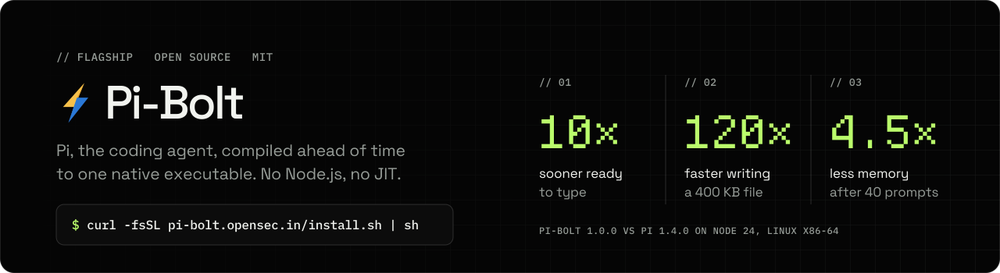

<picture>
  <source media="(prefers-color-scheme: dark)" srcset="assets/banner-dark.svg">
  <source media="(prefers-color-scheme: light)" srcset="assets/banner-light.svg">
  
</picture>

  
  
  
  
  
  

**OpenSec** builds AI-native vulnerability management for enterprise and government security teams: deep white-box
codebase scans, codebase-aware pull request reviews and autonomous pentesting, joined into one workflow from the attack
path to the line of code and the fix that closes it.

Research is our proving ground. We have found **150+ CVEs across 100+ open-source repositories**, among them Argo CD,
Apache Airflow, FreeRDP, Gitea and rclone. Published records are on the
[disclosure ledger](https://opensec.in/#disclosures).

## Open source

<picture>
  <source media="(prefers-color-scheme: dark)" srcset="assets/pi-bolt-dark.svg">
  <source media="(prefers-color-scheme: light)" srcset="assets/pi-bolt-light.svg">
  
</picture>

  
  
  
  

Extensions for Pi and Pi-Bolt, offered by the Pi-Bolt installer:

- **[opensec-pi-subagents](https://github.com/opensec-git/opensec-pi-subagents)**: specialized agents in separate sessions that inherit the parent's model and thinking level, with parallel workflows and scheduled jobs.
- **[opensec-pi-todo](https://www.npmjs.com/package/opensec-pi-todo)**: a todo list for the model, shown as a live panel that survives `/reload` and compaction.
- **[opensec-pi-fff](https://www.npmjs.com/package/opensec-pi-fff)**: fast fuzzy file and content search, with find, grep and `@`-mentions.

Add one with `pi-bolt install npm:<name>`. Pi-Bolt itself also installs with npm,
[Homebrew](https://github.com/opensec-git/homebrew-tap), [Scoop](https://github.com/opensec-git/scoop-bucket) and mise.

## Stack

  
  
  
  
  
  
  
  

<code>// SEE DEEPER INTO YOUR CODE. GET AHEAD OF ATTACKERS. SECURE WHAT MATTERS.</code>
